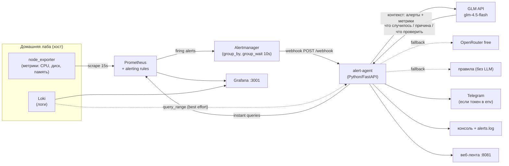

# Архитектура — homelab-monitor

## Общая схема

## Поток данных при инциденте

1. **Сбор.** `node_exporter` отдаёт метрики хоста, Prometheus скрапит их каждые 15s.
2. **Срабатывание правила.** Prometheus вычисляет правила из `alerts.yml`:
   - `HighDiskUsage` — заполнение ФС > 92% (1 минуту подряд);
   - `HighCPUUsage` — загрузка CPU > 90% в течение 5 минут;
   - `ServiceDown` — цель скрапа не отвечает (`up == 0`, 1 минуту).
3. **Alertmanager.** Группирует по `alertname`, ждёт `group_wait: 10s` и отправляет
   webhook на `alert-agent` (`POST /webhook`). `repeat_interval: 3h` защищает от дублей.
4. **Агент** (конвейер в фоне, ответ на webhook — сразу 200):
   - парсит payload (статус, лейблы, аннотации, `startsAt`);
   - cooldown-гейт: повтор той же группы (`alertname` + `instance`) в пределах 600s
     подавляется, счётчик повторов вклеивается в следующее уведомление;
   - подтягивает контекст из Prometheus API: instant queries по карте «тип алерта →
     метрики» (для диска — заполнение по mountpoint, для CPU — загрузка/load/memory,
     для down — `up` по всем целям) + лучшие усилия: последние записи из Loki;
   - собирает промпт (системный: три раздела с точными заголовками; пользовательский:
     сырые алерты + метрики) и вызывает LLM.
5. **LLM-цепочка с fallback.** GLM (`glm-4.5-flash`, thinking отключён — иначе
   модель тратит токены на рассуждения) → OpenRouter (free) → rule-based текст
   с чек-листом по типу алерта и метриками. Ретраи с экспоненциальной паузой,
   connect-timeout 15s отдельно от общего. Ответ валидируется: в нём обязаны быть
   все три раздела, иначе пробуется следующий провайдер.
6. **Уведомления.** Консоль-лог, `agent/data/alerts.log`, Telegram (Bot API,
   включается наличием `TELEGRAM_BOT_TOKEN` + `TELEGRAM_CHAT_ID` в env), запись в
   ленту (`agent/data/alerts.json` → `GET /api/alerts`).

## Компоненты

| Компонент | Роль | Порт (host) |
|---|---|---|
| Prometheus | сбор метрик, вычисление alerting rules | 9090 |
| Alertmanager | группировка и доставка алертов (webhook) | 9093 |
| node_exporter | метрики хоста (profile `full`) | 9100 |
| Loki | агрегация логов | 3100 |
| Grafana | дашборды (datasources автоподключены) | 3001 |
| alert-agent | AI-слой: контекст → LLM → уведомления + лента | 8081 |

alert-agent работает в `network_mode: host`: в bridge-сети этого стенда исходящий
TLS до внешних LLM-провайдеров периодически зависает на handshake; alertmanager
достаёт вебхук агента через `host.docker.internal` (`extra_hosts: host-gateway`).

## Замеры конвейера (демо, локальный стенд)

| Этап | ServiceDown | HighDiskUsage |
|---|---|---|
| воздействие → pending | 24 s | ~10 s |
| pending → firing (`for:`) | 60 s | 60 s |
| firing → webhook (`group_wait`) | ~10 s | ~10 s |
| конвейер агента (контекст+LLM+notify) | 11 s | 15 s |
| **итого** | **~105 s** | **~85–90 s** |

HighCPUUsage: окно `rate[5m]` + `for: 5m` → ~10 мин от старта нагрузки до уведомления.

## Роли AI-слоя

AI не принимает решений и не выполняет действий на хосте — только превращает
технический сигнал в объяснение. Это принципиально для демо-кейса:
агент встраивается в существующий стек, а не заменяет его.

## Границы (демо)

- Один хост, локальный запуск через Docker Compose.
- Действия агента read-only относительно инфраструктуры.
- Все замеры — локальные, помечаются «демо».
