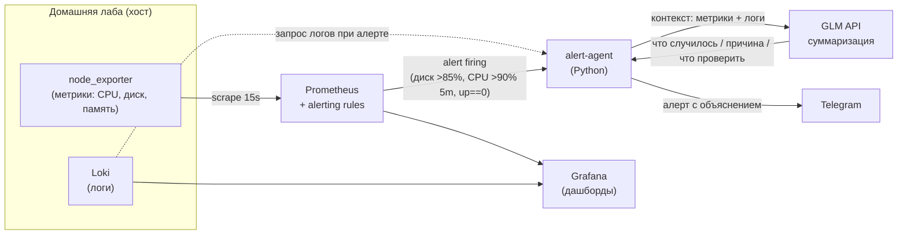

# Архитектура — homelab-monitor

## Общая схема

## Поток данных при инциденте

1. **Сбор.** `node_exporter` отдаёт метрики хоста, Prometheus скрапит их каждые 15s. Loki собирает логи.
2. **Срабатывание правила.** Prometheus вычисляет правила из `alerts.yml`:
   - `HighDiskUsage` — заполнение ФС > 85% (2 минуты подряд);
   - `HighCPUUsage` — загрузка CPU > 90% в течение 5 минут;
   - `ServiceDown` — цель скрапа не отвечает (`up == 0`).
3. **Агент.** `alert-agent` получает сработавший алерт (webhook от Prometheus Alertmanager / опрос API), подтягивает:
   - связанные метрики за окно инцидента (Prometheus API);
   - последние записи логов (Loki API).
4. **Суммаризация.** Агент формирует промпт с контекстом и отправляет в **GLM API**. LLM возвращает структурированное объяснение:
   - что случилось (на естественном языке);
   - вероятная причина (по метрикам и логам);
   - что проверить (конкретные команды/места).
5. **Доставка.** Готовое сообщение уходит в **Telegram** (Bot API, `TELEGRAM_CHAT_ID`).

## Компоненты

| Компонент | Роль | Порт |
|---|---|---|
| Prometheus | сбор метрик, вычисление alerting rules | 9090 |
| node_exporter | метрики хоста (profile `full`) | 9100 |
| Loki | агрегация логов | 3100 |
| Grafana | дашборды и визуализация | 3000 |
| alert-agent | AI-слой: контекст → GLM → Telegram | — (вечер 2) |

## Роли AI-слоя

AI не принимает решений и не выполняет действий на хосте — только превращает
технический сигнал в объяснение. Это принципиально для демо-кейса:
агент встраивается в существующий стек, а не заменяет его.

## Границы (демо)

- Один хост, локальный запуск через Docker Compose.
- Действия агента read-only относительно инфраструктуры.
- Все замеры — локальные, помечаются «демо».
